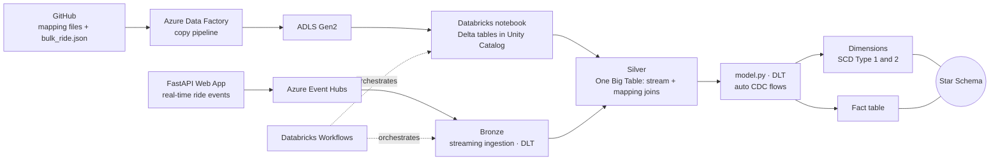

# Uber Real-Time Streaming Lakehouse


-FF3621)


An end-to-end **streaming lakehouse** on Azure and Databricks. A FastAPI app produces real-time Uber-style ride events into **Azure Event Hubs**. **Spark Declarative Pipelines (DLT)** ingest them into a Medallion architecture on **Delta Lake** (governed by **Unity Catalog**), enrich them with reference data into a **One Big Table (OBT)**, and model a **star schema** with **SCD Type 1 and Type 2** dimensions using auto CDC flows.

## At a glance

| | |
|---|---|
| **Goal** | Ingest live ride events, enrich them and serve an analytics-ready star schema |
| **Ingestion** | FastAPI producer → Azure Event Hubs (streaming) and ADF (GitHub → ADLS Gen2, batch) |
| **Processing** | Databricks Spark Declarative Pipelines (DLT), PySpark, Spark Structured Streaming |
| **Storage** | ADLS Gen2, Delta Lake, Unity Catalog |
| **Modeling** | Bronze → Silver (OBT) → Gold star schema, SCD Type 1 and 2 |
| **Orchestration** | Databricks Workflows (notebooks + pipeline) |

## Architecture




## How it works

1. **Real-time ingestion:** A FastAPI ride-booking web app generates a fake Uber ride confirmation (using Faker) each time `/book` is called and publishes it as JSON to Azure Event Hubs.
2. **Batch and reference data:** An ADF pipeline copies the static files (`Vehicle_type.json`, `vehicle_make.json`, `map_cities.json`, `payment_details.json`, etc.) and the historical `bulk_ride.json` from GitHub into ADLS Gen2.
3. **Delta tables:** A Databricks notebook creates Delta tables in Unity Catalog from the files landed in ADLS.
4. **Bronze:** Spark Declarative Pipelines (DLT) read the Event Hubs stream into the Bronze layer.
5. **Silver:** The streaming table is joined with all mapping tables to build a single enriched **One Big Table (OBT)**.
6. **Gold (star schema):** `model.py` builds dimension tables with **SCD Type 1 and SCD Type 2** using `auto_cdc_flow`, plus the fact table, all derived from the OBT.
7. **Orchestration:** Databricks Workflows runs the notebook and the DLT pipeline in order.

## Tech stack

- **Cloud:** Azure Event Hubs, Azure Data Factory, ADLS Gen2
- **Data platform:** Databricks, Delta Lake, Unity Catalog, Spark Declarative Pipelines (DLT), Databricks Workflows
- **Processing:** PySpark, Spark Structured Streaming, SQL
- **Application:** Python, FastAPI, Jinja2 templates, Faker, python-dotenv, azure-eventhub
- **Data modeling:** Medallion architecture, OBT, star schema, SCD Type 1 and 2


## Repository structure

```text
Uber_Streaming_Project/
├── Supporting Files/   # Ingestion layer: FastAPI app + data generator
│   ├── api.py                    # FastAPI app ( / home page, /book sends a ride to Event Hubs )
│   ├── connection.py             # Event Hubs producer (reads credentials from .env)
│   ├── data.py                   # Generates fake ride confirmations
│   ├── templates/                # home.html, confirmation.html
│   └── Data/                     # Mapping files and bulk_ride.json
│   └── Screenshot/               # Run Outcome supporting docs
├── Databricks_Pipeline/          # Databricks pipelines, notebooks and model.py
└── README.md
```

## Getting started

### Prerequisites
- Azure subscription with an Event Hubs namespace and an ADLS Gen2 account
- Azure Data Factory instance
- Databricks workspace with Unity Catalog enabled
- Python 3.9+

### 1. Run the ride-booking app (producer)
```bash
git clone https://github.com/silentkinght25/Uber_Streaming_Project.git
cd Uber_Streaming_Project/Uber_Data_Engineer_Project
pip install fastapi uvicorn jinja2 faker python-dotenv azure-eventhub
```

Create a `.env` file in this folder (never commit it):
```env
CONNECTION_STRING=<your-event-hubs-connection-string>
EVENT_HUBNAME=<your-event-hub-name>
```

Start the app from this folder (it loads `templates/` by relative path):
```bash
python api.py
```
Open http://localhost:8000 and click through to book a ride, or call `GET /book`. Each booking sends one ride event to Event Hubs. You can also test the producer alone with `python connection.py`.

### 2. Load reference and historical data
Run the ADF pipeline to copy the mapping files and `bulk_ride.json` from GitHub to ADLS Gen2, then run the Databricks notebook to create the Unity Catalog Delta tables.

### 3. Run the streaming pipeline
Deploy the DLT pipeline from `Uber Stream Project/` and trigger the Databricks Workflow to run the notebook and pipeline end to end.


## Key design decisions

- **OBT before the star schema:** Joining the stream with all reference tables once in Silver keeps downstream modeling simple and consistent.
- **SCD Type 1 and 2 via `auto_cdc_flow`:** Dimension changes are tracked declaratively instead of through hand-written merge logic.
- **Declarative pipelines:** DLT handles checkpoints, dependencies and incremental processing.
- **Unity Catalog governance:** Tables are centrally governed and discoverable.

## Future improvements

- Data quality expectations on the Bronze and Silver layers
- CI/CD with Databricks Asset Bundles and Azure DevOps
- Dashboard on the star schema (Power BI or Databricks SQL)
- Infrastructure as code with Terraform

## Author

**Ashwani Singh**, Data Engineer
[LinkedIn](https://www.linkedin.com/in/kneashwanisingh/) · [GitHub](https://github.com/silentkinght25)
